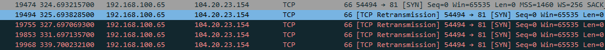

# Day 4 방화벽 규칙 보고서 · 오후 (이름 · 2026-10-15)

> **쓰는 법**
> - 문제를 하나 풀 때마다 그 문제 제목 아래를 채웁니다.
> - 질문마다 `쓸 내용:` 에 **무엇을 몇 가지 쓰면 되는지** 적혀 있습니다. 그대로 따라 `답:` 뒤에 씁니다.
> - 「왜 그럴까요?」 같은 질문은 한 단어로 끝내지 말고, 내 화면에서 본 값이나 배운 내용을 근거로 이유까지 씁니다.
> - 🔍 는 그 교시에 꼭 알아야 할 핵심 질문입니다. 답을 못 찾았으면 「모름 — 막힌 곳: …」 이라고 씁니다.

---

## 5교시 · 규칙 읽기 · 로그

### 문제 5-1 · 5교시 규칙표로 요청 세 개를 손으로 판정하기

- (가) 세 요청마다 처음 맞은 규칙 번호와 허용 / 차단을 적어 주세요.
  - 쓸 내용: 「A 규칙 ○ · 허용 또는 차단」처럼 세 줄
  - 답: A 규칙o 허용 / B 규칙 x 차단 / C 규칙 x 차단

- (나-1) 🔍 A 와 B 는 같은 부산 지점이 같은 포트로 가는데 결과가 다릅니다. 무엇이 달라서일까요?
  - 쓸 내용: ① 두 요청에서 달라진 값 하나 ② 그 값 때문에 각각 몇 번 규칙에 맞았는지
  - 답: 목적지가 다르다. 따라서 A는 3번 규칙에 맞기에 허용이지만, B는 규칙에 맞지 않아 차단이다.

- (나-2) 🔍 5번 줄을 맨 위(1번 자리)로 올리면 A ~ C 는 각각 어떻게 될까요? 그래서 `any` 규칙은 어디에 둬야 할까요?
  - 쓸 내용: ① A ~ C 의 새 결과 ② `any` 규칙을 둘 위치와 이유
  - 답: A/B/C = 차단
  5번줄을 맨 위로 올리면 아래 허용되는 규칙이 있더라도 any 라는 모두 포함되는 값이라 전부 차단이 된다.
  따라서 any 규칙은 제일 마지막에 둬야한다

### 문제 5-2 · 허용된 연결과 막힌 연결을 Wireshark 로 재 보기
104.20.23.154
- (가-1) 80번 연결의 `[SYN]` 과 `[SYN, ACK]` 두 줄의 `Time` 값, 그리고 두 값의 차이(RTT)를 ms 로 적어 주세요.
  - 쓸 내용: `[SYN]` 줄의 `Time`, `[SYN, ACK]` 줄의 `Time`, 두 값의 차이를 ms 로 계산한 값
  - 답: SYN 41.656831200 / SYN, ACK 41.694238400 / 0.0374072ms

- (가-2) 81번 연결에서 SYN 이 몇 번 나갔는지, 줄마다의 `Time` 값, 상대에게서 온 것(SYN/ACK · RST · 없음), `curl` 의 마지막 문구를 적어 주세요.
  - 쓸 내용: ① SYN 횟수 ② 줄마다의 `Time` 값 ③ 상대에게서 온 것 ④ `curl` 마지막 문구 한 줄
  - 답: 5번 / 324.693215700	325.693828500 327.697069300 331.697135700 339.700232100 / 
  [TCP Retransmission] 54494 → 81 [SYN] Seq=0 Win=65535 Len=0 MSS=1460 WS=256 SACK_PERM / 
  curl: (28) Connection timed out after 15007 milliseconds

- (나-1) 🔍 81번 연결은 3-way handshake 의 어디에서 멈췄나요? 5.2 의 두 방식 가운데 어느 쪽이고, 그렇게 판단한 근거 화면은 무엇인가요?
  - 쓸 내용: ① 멈춘 단계(SYN · SYN/ACK · ACK 가운데) ② 드롭 / 거부 가운데 하나와 근거 화면
  - 답: SYN / 드롭 / 거부나 차단이 되었으면 SYN,ACK 나 RST 가 나왔어야하는데 5줄 모두 SYN 이다.


- (나-2) 81번 SYN 줄의 `Time` 값으로 SYN 사이의 간격을 구해 적어 주세요. 간격은 일정했나요, 늘어났나요?
  - 쓸 내용: ① (가-2) 의 `Tiframe.time_relative == 331.697135700me` 값으로 구한 줄 사이 간격 두 가지(앞부분 · 뒷부분, 예: 1.0초, 2.0초) ② 간격이 일정했는지, 늘어났는지
  - 답: 앞의 간격 4초, 뒷부분 간격 8초 / 간격이 늘어났다.

- (다) 아래 방화벽 로그의 14:05 네 줄을 `10.8.0.21` PC 쪽에서 패킷으로 보면 어떤 모습일까요? 무엇을 하려던 기록으로 보이는지, 다음에 어떤 기록을 확인하면 좋을지도 적어 주세요.
  - 쓸 내용: ① 패킷으로 보이는 모습(무엇을 보내고 무엇이 안 왔는지) ② 목적지 · 포트 · 간격으로 본 행동 ③ 다음에 확인할 기록
  - 답: SYN 을 보내고, RST 또는 차단이라고 답으로 온다. / SSH/22, HTTPS/443, DB/3306, DB/5432 각 1초 / 해당 IPv4 주소가 어떻게 접속했는지 VPN 게이트웨이 접속로그를 확인해야한다.

- (라) (선택) 사용자가 「회사 서버에 접속이 안 된다」고 합니다. 패킷만 보고 방화벽 문제인지 서버 문제인지 어떻게 나눌 수 있을까요?
  - 쓸 내용: 응답이 아예 없을 때 · RST 가 올 때 · SYN/ACK 가 올 때 각각 무엇을 의심하고 먼저 어디를 볼지. 선택 문항이라 안 쓰면 「선택 안 함」이라고 적습니다
  - 답:
  응답이 아예 없을 때: 방화벽 차단이나 경로를 의심하고, 방화벽 로그에서 차단 기록을 본다.
  RST 가 올 때: 서버가 거절한 것 서비스가 꺼져 있거나 다른 포트를 쓰는지 서버 쪽을 의심하고, 서버의 서비스 실행 상태와 LISTENING 포트를 먼저 본다. 방화벽이 RST로 거절하도록 설정된 경우도 있어 방화벽 규칙도 함께 확인한다.
  SYN/ACK 가 올 때: 인증을 의심하고 서버 애플리케이션 로그를 먼저 본다.

### 이 교시에 새로 안 것

- 이 교시에서 새로 알게 된 것 하나를 적어 주세요. (「이 교시에 새로 안 것」 칸)
  - 쓸 내용: 새로 안 것 하나와, 그게 왜 기억에 남는지
  - 답: 와이어프레임으로 접속 허용 실패 여부 확인

---

## 6교시 · 허용 목록 · 규칙 순서

### 문제 6-1 · 학원 방화벽은 허용 목록일까 차단 목록일까

- (가) 포트 443 · 445 · 3389 마다 「열림 · 드롭 · 거부」 판정과 근거(`curl` 문구 · Wireshark 화면)를 한 줄씩 적어 주세요.
  - 쓸 내용: 「443: 열림 — Port test successful!」처럼 포트마다 한 줄, 판정과 근거
  - 답:
  443 : 열림 Port test successful! 
  445 : 드롭 curl: (28) Connection timed out after 5014 milliseconds
  3389 : 열림 Port test successful!

- (나) 🔍 이 결과로 보면 학원 방화벽은 허용 목록과 차단 목록 가운데 어느 쪽에 가까운가요? 근거가 된 포트를 들어 적어 주세요.
  - 쓸 내용: ① 허용 목록 / 차단 목록 / 알 수 없음 가운데 하나 ② 근거가 된 포트와 그 결과 ③ 안내 6.1 표의 어느 줄과 맞는지
  - 답: 차단목록 / 웹 접속이나 원격 데스크톱 같은 경우를 굳이 허용목록으로 반영해서 정하진 않고, 445 같이 파일 공유 같은 것을 차단 목록으로 지정해서 사용

- (다-1) 포트 세 개만 보고 내린 판단에는 어떤 한계가 있을까요? 더 확실하게 알려면 무엇을 더 해야 할까요?
  - 쓸 내용: ① 한계 한 가지 ② 더 해야 할 시험 한 가지
  - 답: 검사한 포트는 3개뿐이라, 나머지 남아있는 포트들을 확인 할 수 없어 한계점이 존재하고, 정확하게  하려면
  통상적으로 허용을 해두는 포트나 차단을 해두는 포트들을 확인해서 허용목록인지 차단목록인지 확인해야한다.

- (다-2) 6번 필터(`tcp.flags.syn == 1 && tcp.flags.ack == 0`)로 바꾸니 2번 필터 화면에서 어떤 패킷이 사라졌나요? 한 PC 가 여러 포트로 연결을 시작한 것을 찾을 때 이 필터를 쓰는 이유는 무엇일까요?
  - 쓸 내용: ① 사라진 패킷의 종류 ② 시작 SYN 만 모아 볼 때 알 수 있는 것
  - 답: SYN으로 요청한 뒤에 돌아오는 SYN,ACK 나 RST 같은 답이 없어졌다.
  이렇게 되면 한 포트에 여러번 요청하는 포트스캔을 탐지할 수 있다.

### 문제 6-2 · 허용했는데 왜 막힐까 — 규칙 순서 고치기

- (가-1) 처음 규칙표로 판정한 세 요청의 처음 맞은 규칙 번호와 허용 · 차단을 적어 주세요.
  - 쓸 내용: 「A 규칙 ○ · 허용 또는 차단」처럼 세 줄
  - 답: 
  A 규칙 차단 / B 규칙 차단 / C 규칙 차단

- (가-2) 2번과 3번을 위로 올린 규칙표로 판정한 세 요청의 처음 맞은 규칙 번호(올린 뒤의 번호)와 허용 · 차단을 적어 주세요.
  - 쓸 내용: 「A 규칙 ○ · 허용 또는 차단」처럼 세 줄
  - 답: A 규칙 허용 / B 규칙 허용 / C 규칙 차단

- (나) 🔍 처음 규칙표에서 업무 포털 허용 규칙(2번)이 있는데도 왜 막혔을까요?
  - 쓸 내용: ① 처음 규칙표 1번의 목적지 범위와 포트 ② 업무 포털 주소가 그 범위에 들어 있는지 ③ 그래서 2번까지 가지 못한 이유
  - 답: 처음 1번의 규칙이 서브넷 마스크 대역이 2번째 구역 까지라 10.10.0.0 ~ 10.10.255.255 까지 모두 차단 하게 되어있어서
  A,B 가 모두 저 범위 안에 속해 첫번째 규칙에 적용되어 2번째 규칙까지 가지 못했다.

- (다) 반대로 「부산 지점(`192.168.20.0/24`) → 본사 전체(`10.10.0.0/16`) · `any` · 허용」 규칙이 
            「부산 지점 → 고객 DB(`10.10.30.7/32`) · `3306` · 차단」 규칙보다 위에 있으면, 
            부산 지점에서 고객 DB 로 가는 요청은 어떻게 될까요? 어떤 사고가 날까요?
  - 쓸 내용: ① 그 요청이 먼저 맞는 규칙 ② 그래서 생기는 사고
  - 답: 고객 DB의 범위보다 본사 전체의 범위가 더 넓어 차단하는 규칙은 적용되지 않고 부산지점 전체에게 본사 전체 규칙이 허용된다.


### 이 교시에 새로 안 것

- 이 교시에서 새로 알게 된 것 하나를 적어 주세요. (「이 교시에 새로 안 것」 칸)
  - 쓸 내용: 새로 안 것 하나와, 그게 왜 기억에 남는지
  - 답:

---

## 7교시 · 규칙표 직접 쓰기 · 규칙서

### 문제 7-1 · 요구사항을 읽고 규칙표 직접 쓰기

- (가) 처음 실행했을 때의 점수와, `점수: 8 / 8` 이 나올 때까지 몇 번 고쳤는지 적어 주세요.
  - 쓸 내용: 처음 점수 하나와 고친 횟수 하나
  - 답: 처음 5/8 1번 any 에 따옴표를 넣었다

- (나-1) 처음에 틀렸던 시험 하나를 골라, 어느 규칙이 왜 틀렸고 어떻게 고쳤는지 적어 주세요. 한 번에 8 / 8 이었다면, 위에서 다섯째 시험(지점 → 관리 서버 `443`)이 왜 차단되어야 하는지 적어 주세요.
  - 쓸 내용: ① 틀렸던 시험 번호 ② 원인이 된 규칙과 이유 ③ 고친 내용 — 한 번에 맞았으면 시험 5번이 차단되어야 하는 이유(요구사항 ② 의 「만」)
  - 답: 7번 / any에 "" 를 안붙여서 / "" 붙임

- (나-2) 🔍 부산 지점 규칙의 목적지를 서버 하나(`/32`)가 아니라 같은 서버 범위 전체 `10.10.20.0/24` 로 적으면 8개 가운데 어느 시험이 틀릴까요? 요구사항 ② 와 비교해 이유를 적어 주세요.
  - 쓸 내용: ① 틀릴 시험 번호 ② `10.10.20.0/24` 에 들어 있는 서버들 ③ 요구사항 ② 보다 넓게 열리는 이유
  - 답: 5번 / 10.10.20.5,6,9 / 5번의 요구사항은 부산지점이 관리서버에 차단 되게 하는 것인데 대역 /24 로 설정하면서 모든 서버에 허용을 했다.

- (다) 내 규칙표에서 고객 DB(`10.10.30.7`)로 가는 통신을 허용하는 규칙은 몇 줄이고, 누구에게 열려 있나요? 이것이 「DB 서버가 불필요하게 노출되지 않았는가」 기준을 어떻게 지키는지 적어 주세요.
  - 쓸 내용: ① DB 로 가는 허용 규칙 수와 그 출발지 ② 나머지(VPN 직원 · 지점 · 인터넷)가 어느 규칙에 맞는지 ③ 그래서 DB 가 노출되지 않는 이유
  - 답: 1줄, 5번째 10.10.20.5 / VPN직원, 지점, 인터넷 전부 7번 규칙에서 막힌다. 그래서 업무포털 서버에만 열려있어 불필요하게 노출되지 않는다.

### 문제 7-2 · 요구사항이 바뀌었다 — 규칙 한 줄을 어디에 넣을까

- (가) 새로 넣은 규칙 한 줄과, 규칙표에서 몇 번째에 넣었는지 적어 주세요.
  - 쓸 내용: 새 규칙 한 줄을 그대로, 그리고 몇 번째 줄인지
  - 답: 7, "10.8.0.50/32", "10.10.20.9/32", 22, "허용" / 7번째 줄

- (나-1) 🔍 출발지를 `10.8.0.50/32` 가 아니라 `10.8.0.0/24` 로 적으면 10개 가운데 어느 시험이 틀릴까요? 실제로는 어떤 일이 생길까요?
  - 쓸 내용: ① 틀릴 시험 번호 ② `10.8.0.0/24` 가 누구까지 포함하는지 ③ 실제로 생길 수 있는 일
  - 답: 시험 10번(다른 VPN 직원 10.8.0.21 → 관리 서버 22)이 틀린다. /24 는 10.8.0.0~255 전체라 VPN 직원 모두가 관리 서버에 SSH로 접속할 수 있게 된다.

- (나-2) 새 규칙을 「모두 차단」 줄 **아래**에 넣으면 어느 시험이 틀릴까요? 왜 그럴까요?
  - 쓸 내용: ① 틀릴 시험 번호 ② 그 요청이 먼저 맞는 규칙 번호와, 그래서 새 규칙까지 못 가는 이유
  - 답: 9번이 틀린다. 새 규칙보다 위에 있는 8번에 먼저 맞는다. 방화벽은 위에서부터 처음 맞는 규칙에서 멈추기 때문에 그 아래의 새 규칙까지 가지 못하고 차단된다. 그래서 허용 규칙은 반드시 모두 차단 위에 넣어야 한다.

- (다) 관리자의 VPN 주소 `10.8.0.50` 으로 허용했는데, 이 관리자의 VPN 계정 비밀번호가 탈취되면 어떻게 될까요? 방화벽 규칙만으로 막을 수 없는 이유를 오전 4-2 와 이어서 적어 주세요.
  - 쓸 내용: ① 방화벽이 보는 것과 보지 않는 것 ② 비밀번호를 탈취한 공격자가 받는 주소 ③ 오전 4-2 에서 본 VPN 의 한계와 이어서
  - 답: 방화벽은 출발지 IP, 목적지 IP, 포트만 보고 누가 접속했는지는 보지 못한다. 비밀번호를 탈취한 공격자가 관리자 계정으로 VPN에 접속하면 관리자와 같은 VPN 주소(10.8.0.50)를 받으므로, 방화벽에서는 진짜 관리자와 구분되지 않아 관리 서버 SSH 허용 규칙을 그대로 통과한다. 오전 4-2 에서 본 것처럼 VPN은 들어올 때 한 번만 확인하고 들어온 뒤의 행동은 묻지 않으며, VPN 주소만으로는 누가 접속했는지 알 수 없기 때문에 방화벽 규칙만으로는 막을 수 없다. 다중 인증(MFA)이나 접속 기록 감시 같은 다른 통제가 필요하다.

### 문제 7-3 · 방화벽 규칙서 완성하고 올리기

- (가) `git status` 를 쳤을 때 빨간 목록에 줄이 몇 개였는지, 그 가운데 `.env` · `.venv` 가 있었는지 적어 주세요.
  - 쓸 내용: 줄 수 하나와 「`.env` · `.venv` 있음 / 없음」
  - 답: 23줄 / 없음
- (나) 커밋 메시지를 `update` 처럼 쓰지 않고 무엇을 했는지 적어야 하는 이유는 무엇일까요? 오늘 쓸 메시지를 예로 들어 적어 주세요.
  - 쓸 내용: ① 깃허브 커밋 목록에 무엇이 보이는지 ② `update` 로 쓰면 생기는 불편 ③ 오늘 쓸 메시지 예
  - 답: 

### 이 교시에 새로 안 것

- 이 교시에서 새로 알게 된 것 하나를 적어 주세요. (「이 교시에 새로 안 것」 칸)
  - 쓸 내용: 새로 안 것 하나와, 그게 왜 기억에 남는지
  - 답:

---

## 최종 방화벽 규칙서 — 7교시에 완성합니다

> 오늘 오후에 만든 **방화벽 규칙표**를, 처음 보는 사람도 왜 이렇게 썼는지 알 수 있게 정리합니다. 강의계획서의 4일 차 산출물(`day04_firewall_ruleset.md`)을 이 칸이 대신합니다. 위에서 적은 5 · 6 · 7교시의 답을 다시 보며 씁니다.

### 1. 규칙표 — 문제 7-2

- `day04_7-2_rules_admin.py` 의 `RULES = [` 줄부터 `]` 줄까지를 아래 코드 블록 안에 붙여 넣어 주세요.
  - 쓸 내용: 코드의 규칙표 그대로 — 아래 ` ```python ` 줄과 ` ``` ` 줄 사이에 붙입니다
  - 답:

```python

```

- 이 규칙표의 채점 결과(`점수:` 줄)를 적어 주세요.
  - 쓸 내용: `점수: … / 10` 한 줄
  - 답:

### 2. 설계 원칙 — 강의계획서의 평가 기준 세 가지

- 허용 목록(화이트리스트 · 최소 권한)을 어떻게 적용했나요?
  - 쓸 내용: ① 맨 아래 줄의 번호와 동작 ② 요구사항의 「만」을 지키려고 `/32` 로 좁힌 규칙 번호 하나와 이유
  - 답:
- 규칙 순서는 어떤 원칙으로 정했나요?
  - 쓸 내용: ① 좁은 규칙과 넓은 규칙의 위치 ② 7-2 에서 새 규칙을 넣은 위치와 이유(6-2 · 7-2 참고)
  - 답:
- 고객 DB 가 불필요하게 노출되지 않도록 어떻게 했나요?
  - 쓸 내용: ① DB 로 가는 허용 규칙 번호와 출발지 ② 그 밖의 출발지가 맞는 규칙
  - 답:

### 3. 규칙표의 한계 — 문제 7-2 · 오전 4-2

- 이 규칙표를 지켜도 막지 못하는 경우를 하나 적고, 무엇이 더 필요한지 적어 주세요.
  - 쓸 내용: ① 막지 못하는 상황 하나(예: 계정을 빼앗긴 VPN 직원) ② 방화벽이 그것을 못 막는 이유(방화벽이 보는 것) ③ 더 필요한 확인 하나
  - 답:

### 4. 오늘 하루 정리

- VPN 과 방화벽은 각각 무엇을 확인하나요? 한 줄씩 비교해 적어 주세요.
  - 쓸 내용: 「VPN: … 를 확인한다 / 방화벽: … 를 확인한다」 두 줄, 각각 언제 확인하는지도 함께
  - 답:
